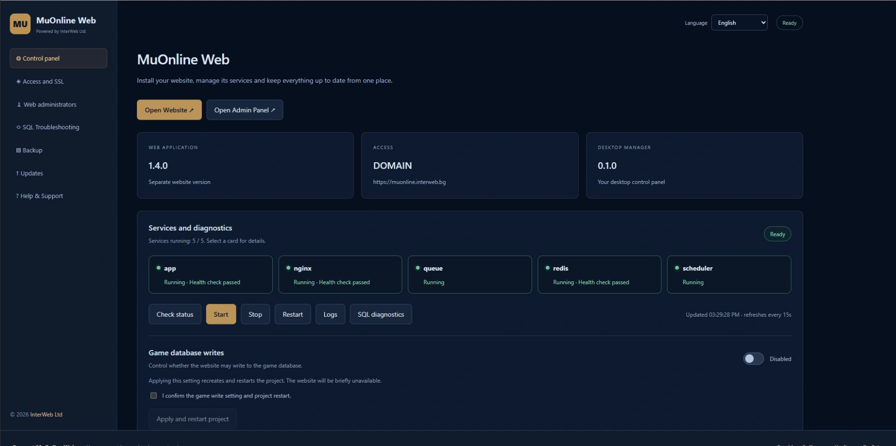

# MuOnline Web Manager



**Powered by [InterWeb Ltd.](https://interweb.bg)**

Install and manage [MuOnline Web](https://github.com/iwebbg/muonline-web-laravel)
from a Windows desktop application, with an English or Bulgarian interface.

[Installation guide](INSTALLATION_GUIDE.md) · [MuOnline Web](https://github.com/iwebbg/muonline-web-laravel) · [Help & Support](https://github.com/iwebbg/muonline-web-manager/issues)

## Download

**[Download MuOnline Web Manager for Windows](https://mega.nz/file/eFMFlZpS#R2T1iPSjXT7faTfhDy6CHrDKuujMivODo50m8Ati2Fs)**

Use the Windows installer to get started. You do not need Node.js, npm or this
source checkout to use the installed manager.

## What the manager does

- Prepares the website environment and guides you through installation.
- Configures the web database and restricted SQL logins against your SQL Server.
- Supports Local, IP and Domain + SSL access, with changes available after installation.
- Opens your website and admin panel directly from the Control panel.
- Configures payments, SMTP, S3 credentials, reCAPTCHA and website options after installation.
- Provides service controls, logs, SQL diagnostics and web administrator management.
- Creates verified SQL backups before web updates and checks for new versions automatically.
- Applies updates only when you choose Update.

The website runs through WSL2 and Docker Engine. Closing the manager leaves the
website services running; the Windows host must remain awake and connected.
SQL Server and an existing MuOnline game database are required. The manager does
not install the game server or SQL Server.

## Installation

1. Prepare SQL Server: enable TCP/IP, configure its port and verify SQL authentication.
2. Install and open MuOnline Web Manager.
3. Enter your SQL connection details, choose your MuServer Version and configure website access.
4. Enter the first web administrator's details and start installation.
5. Follow any Windows permission and restart prompts. Reopen the manager and resume when requested.
6. When setup completes, use Open Website or Open Admin Panel.

Allow approximately 15 minutes for a first installation, depending on your
computer and internet connection. Required passwords must be re-entered after
restarting; non-password installation settings are saved.

See the [step-by-step installation guide](INSTALLATION_GUIDE.md).
For public HTTPS access, your domain and network must route TCP ports 80 and 443
to the website host. Do not expose SQL Server to the public internet for a local setup.

## Testing and source transparency

The source is available here for inspection. Source availability helps review;
it does not, by itself, verify that a downloaded executable matches that source.

User-reported installation tests succeeded on Windows 10, Windows 11,
Windows Server 2022 and Windows Server 2025 with a desktop environment.
The user also confirmed Domain + SSL access and a web update from 1.3.0 to 1.4.0,
including persistence of the installed version after restart. These reports cover
the tested builds and environments, rather than every Windows configuration.
See [review evidence and remaining checks](docs/review.md) for further details.

## Development

See [Contributing](CONTRIBUTING.md) for the branch and review policy.

```sh
npm ci
# If npm withheld dependency scripts: node node_modules/electron/install.js
npm start
npm test
npm run test:ui
```

Node 24+ is needed for development only. `test:ui` needs a graphical session or Xvfb
on Linux. Runtime operations intentionally reject Linux desktop execution.
If your terminal sets `ELECTRON_RUN_AS_NODE`, unset it before `npm start`.

On Windows, `npm run dist:win` builds the assisted NSIS installer. The
[Windows CI workflow](.github/workflows/windows.yml) builds and retains review
artifacts without publishing. It can run after the branch is pushed by an operator.

- [Website settings (manager 0.2.0)](docs/website-settings.md)
- [Architecture and security boundaries](docs/architecture.md)
- [Build, sign and distribute releases](docs/releases.md)
- [Web administrator and Game Master management](docs/administrators.md)
- [SQL Troubleshooting: EN/BG diagnostics and Windows VM checks](docs/sql-troubleshooting.md)
- [Recovery and operational limits](docs/recovery.md)
- [Acceptance checklist and local evidence](docs/review.md)
- [Audit findings and corrections](docs/audit-2026-11-17.md)
- [Project maintenance skill](skills/muonline-manager/SKILL.md)

Production release signing requires an operator-owned Ed25519 key, its public key
pinned in `build/trust.json`, and actual published artifacts. An empty trust store
blocks deployment; keep the pinned public key matched to the release signing key. No R2 objects are assumed to exist or uploaded by CI.

## License

[MIT License](LICENSE). Copyright © 2026 InterWeb Ltd.

Support development: [Buy Me a Coffee](https://buymeacoffee.com/interweb.bg) ·
[Ko-fi](https://ko-fi.com/interwebltd) · [PayPal](https://paypal.me/interwebltd).
